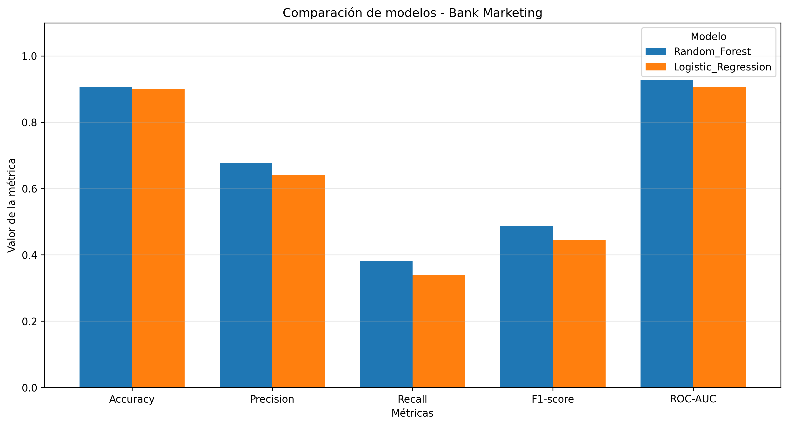

# Actividad 5 — Comparación de modelos de clasificación con MLflow

## 1. Descripción del proyecto

Este proyecto tiene como objetivo desarrollar, entrenar, ajustar y comparar dos algoritmos de aprendizaje automático para resolver un problema de clasificación binaria utilizando el dataset **Bank Marketing**.

Los modelos utilizados son:

- Regresión Logística (Logistic Regression).
- Bosque Aleatorio (Random Forest).

El proyecto implementa técnicas de preprocesamiento, validación cruzada, optimización de hiperparámetros mediante GridSearchCV y seguimiento de experimentos con MLflow.

## 2. Fuente del dataset

**Nombre:** Bank Marketing.

**Fuente:** UCI Machine Learning Repository.

**Identificador del dataset:** 222.

**Enlace:** https://archive.ics.uci.edu/dataset/222/bank+marketing

El dataset contiene información relacionada con campañas de marketing de una institución bancaria portuguesa.

El objetivo es predecir si un cliente contratará un depósito a plazo.

La variable objetivo es `y`:

- `yes`: el cliente contrató el depósito.
- `no`: el cliente no contrató el depósito.

Se trata de un problema de clasificación binaria.

## 3. Estructura del repositorio

```text
Actividad-5/
│
├── datos/
│   ├── datos_ini/
│   └── datos_limp/
│
├── fuentes/
│   ├── entrena.ipynb
│   ├── datos_prep.py
│   └── train.py
│
├── evidencias/
│   ├── resultados_mlflow.csv
│   └── comparacion_modelos.png
│
├── README.md
└── CHANGELOG.md
```

La carpeta `datos_ini` está destinada a los datos originales y `datos_limp` a los datos preparados. El proyecto utiliza `ucimlrepo` para descargar el dataset desde su fuente original.

## 4. Preparación y transformación de datos

El procesamiento de datos se realiza mediante el archivo `datos_prep.py`.

Las principales actividades implementadas son:

1. Obtención del dataset desde UCI.
2. Inspección de tipos de datos y valores nulos.
3. Separación de variables predictoras y variable objetivo.
4. Conversión de la variable objetivo a valores binarios.
5. Identificación de variables numéricas y categóricas.
6. Estandarización de variables numéricas con StandardScaler.
7. Codificación de variables categóricas mediante OneHotEncoder.
8. División estratificada del dataset en 80 % entrenamiento y 20 % prueba.

Las transformaciones se integran en un pipeline para evitar ajustar el preprocesamiento sobre los datos de prueba durante el entrenamiento.

La inspección de valores nulos no implica automáticamente su eliminación o imputación; estas decisiones deben justificarse según los resultados de la exploración de datos.

## 5. Modelos de aprendizaje automático

### Regresión Logística

Algoritmo de clasificación utilizado como modelo de referencia por su sencillez e interpretabilidad.

Se ajustaron los siguientes hiperparámetros:

- `C`: 0.1, 1.0 y 10.0.
- `max_iter`: 1000.
- `random_state`: 42.

### Random Forest

Algoritmo de ensamble basado en múltiples árboles de decisión, utilizado para capturar relaciones no lineales entre las variables.

Se evaluaron los siguientes hiperparámetros:

- `n_estimators`: 50 y 100.
- `max_depth`: 10 y 20.
- `random_state`: 42.

## 6. Validación cruzada y optimización

Se implementó GridSearchCV con validación cruzada estratificada de cinco particiones.

La métrica utilizada para seleccionar la mejor configuración fue ROC-AUC.

Esta estrategia permite comparar diferentes combinaciones de hiperparámetros y seleccionar el modelo con mejor desempeño promedio durante la validación.

## 7. Resultados obtenidos

Los resultados registrados en MLflow fueron:

| Métrica | Regresión Logística | Random Forest |
|---|---:|---:|
| Accuracy | 0.9005 | 0.9062 |
| Precision | 0.6411 | 0.6762 |
| Recall | 0.3393 | 0.3809 |
| F1-score | 0.4438 | 0.4873 |
| ROC-AUC | 0.9061 | 0.9281 |
| ROC-AUC validación cruzada | 0.9070 | 0.9293 |

Random Forest obtuvo los mejores resultados en todas las métricas evaluadas.

Sin embargo, ambos modelos presentan valores de recall relativamente bajos, lo que indica que no identifican correctamente una proporción importante de los casos positivos.

Por tanto, el accuracy no debe utilizarse como único criterio de evaluación.

## 8. Comparación visual

La siguiente gráfica presenta la comparación de las principales métricas de clasificación:



Los resultados exportados de MLflow se encuentran en:

`evidencias/resultados_mlflow.csv`

## 9. Seguimiento de experimentos con MLflow

Se utilizó MLflow para registrar:

- Nombre de cada ejecución.
- Hiperparámetros seleccionados.
- Accuracy, Precision, Recall, F1-score y ROC-AUC.
- Mejor ROC-AUC de validación cruzada.
- Modelos entrenados.
- Resultados de GridSearchCV como artefactos CSV.

El experimento se denominó:

`Bank_Marketing_Classification`

Durante las pruebas se utilizó seguimiento local de MLflow dentro del entorno de Google Colab.

El archivo CSV incluido en el repositorio contiene métricas exportadas del seguimiento de MLflow, pero no sustituye la base de datos ni los artefactos originales del experimento.

## 10. Reproducción del proyecto

El proyecto puede ejecutarse en un entorno Python compatible con las bibliotecas utilizadas.

Instalar dependencias:

```bash
pip install pandas numpy scikit-learn mlflow ucimlrepo matplotlib
```

Descargar el repositorio:

```bash
git clone https://github.com/EmmaMMtz/Actividad-5.git
```

Acceder a la carpeta de entrenamiento:

```bash
cd Actividad-5/fuentes
```

Ejecutar:

```bash
python train.py
```

El script descarga los datos, realiza el preprocesamiento, entrena ambos modelos, ejecuta GridSearchCV y registra los resultados en MLflow.

Para visualizar los experimentos se requiere configurar y abrir una instancia de MLflow que tenga acceso al almacenamiento de seguimiento correspondiente.

## 11. Versionamiento

Git y GitHub se utilizan para mantener el historial de modificaciones del proyecto.

Las principales actividades de versionamiento incluyen:

- Creación de la estructura del repositorio.
- Incorporación del notebook de entrenamiento.
- Separación del código de preparación y entrenamiento.
- Integración del seguimiento con MLflow.
- Corrección de errores de serialización e indentación.
- Incorporación de resultados y evidencias.

El archivo `CHANGELOG.md` documentará las modificaciones realizadas.

## 12. Reflexión sobre MLOps y deuda técnica

El uso de GitHub y MLflow permite mejorar la trazabilidad y organización del ciclo de vida de los modelos.

Entre los beneficios se encuentran el seguimiento de experimentos, la comparación de métricas y la separación entre preparación de datos y entrenamiento.

Se identifican oportunidades de mejora relacionadas con:

- Persistencia del almacenamiento de MLflow.
- Control de versiones de dependencias.
- Automatización del entrenamiento.
- Pruebas del preprocesamiento.
- Monitoreo de desempeño.
- Gestión del desequilibrio entre clases.
- Evaluación de cambios en los datos a lo largo del tiempo.

Estas mejoras permitirían evolucionar el proyecto hacia una implementación de MLOps más reproducible y mantenible.

## 13. Conclusión

Se entrenaron y compararon dos modelos de clasificación utilizando el dataset Bank Marketing.

Random Forest presentó un mejor desempeño que Regresión Logística, especialmente en ROC-AUC y F1-score.

El proyecto demuestra la aplicación de técnicas de preprocesamiento, validación cruzada, optimización de hiperparámetros y seguimiento de experimentos mediante MLflow.

Aunque los resultados son favorables en términos de ROC-AUC, el recall evidencia la necesidad de seguir optimizando la identificación de clientes que contratan depósitos a plazo.
